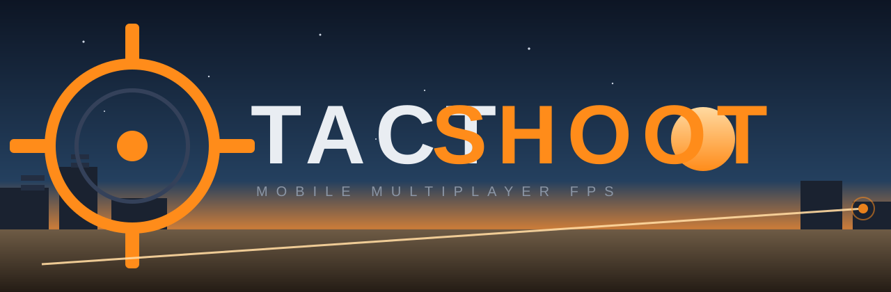

# TactShoot

**A complete, free-to-play 3D multiplayer FPS for Android** — real-time shadows, dynamic skies, post-processing, three handcrafted maps, five weapons, smart AI bots for offline practice, and online multiplayer with matchmaking + private room codes. No Firebase, no paid backend: the entire server is one Node.js file you can host for free.



---

## What's inside

| | |
|---|---|
| **Engine** | LibGDX 1.14.2 (OpenGL ES 2.0/3.0) — runs on Android 7.0+ |
| **Graphics** | Directional light + 2048px shadow mapping, procedural sky (sun, stars, dusk), post-FX (color grade, vignette, chromatic aberration, film grain), particle system (muzzle flash, tracers, shell casings, sparks, smoke, explosions), baked-AO PBR-style textures |
| **Maps** | Dustyard (desert outpost), Facility (dusk industrial yard), Arena (symmetric kill-box) — all with cover, verticality, interior spaces |
| **Weapons** | Assault Rifle, SMG, Shotgun, Pistol + frag grenades. ADS, recoil, spread bloom, per-shell shotgun reload |
| **Offline** | Practice mode vs AI bots with 3 difficulty levels, pathfinding, line-of-sight aiming and burst fire |
| **Online** | Matchmaking (TDM/FFA), private rooms with shareable 4-letter codes, 15 Hz state sync with interpolation, server-authoritative damage, text chat, global leaderboard |
| **Extras** | Procedurally synthesized sound effects (zero audio files), runtime-generated UI, share buttons, stats + landing page served by the game server |

## Quick start

### 1. Build the APK (Android Studio)

1. Open **Android Studio**, choose **Open**, select this folder.
2. Wait for the Gradle sync (first sync downloads Gradle 9.3.1 + dependencies).
3. **Build → Build App Bundle(s) / APK(s) → Build APK(s)**.
4. Find the APK at `android/build/outputs/apk/debug/android-debug.apk` — install it on any Android 7.0+ phone, or use **Build → Generate Signed App Bundle / APK** to make a release APK for sharing.

> The project already contains `local.properties` pointing at `%LOCALAPPDATA%\Android\Sdk`. If your SDK lives elsewhere, update that file.

### 2. Run on desktop (optional, for development)

```
gradlew.bat :desktop:run
```

WASD move, mouse look, LMB fire, RMB aim, R reload, Q switch, G grenade, C crouch, T chat, TAB scoreboard, ESC pause.

### 2b. Automated checks (optional)

```
gradlew.bat :core:physicsCheck          # headless movement/collision regression tests
gradlew.bat :core:inputCheck            # headless touch joystick/look/fire direction tests
gradlew.bat :desktop:smokeRender        # boots a bot match and writes screenshots to build/smoke
gradlew.bat :android:emulatorCheck      # installs the APK on an emulator and drives real touch input
```

`smokeRender` accepts `TACTSHOOT_QUALITY=0|1|2` (graphics preset) and `TACTSHOOT_MODE=game|gun`
(full match or weapon-viewmodel only) so every quality tier can be verified from a terminal.

`emulatorCheck` needs a running emulator (or an installed AVD it can boot headlessly). It starts
the game with `--ez tactshoot.debugInput true --ez tactshoot.autostartPractice true`, which turns
on `TSDBG` logcat telemetry and jumps straight into a bot match. The script then swipes the
joystick, drags the look area and holds the fire button through `adb shell input`, and asserts the
game's own reported position, yaw and ammo. Pass `--check-env` to see the SDK/AVD it will use, or
`--self-test` to validate the driver's parsing and assertions on a machine without an emulator.

### 3. Run the multiplayer server

```
cd server
npm install
npm start
```

You now have a full game server at `ws://localhost:8080` with a landing page at `http://localhost:8080/`.

To play from your phone against your PC-hosted server:
- **Same Wi-Fi**: in the game, *Online → GAME SERVER* field, enter `ws://<your-pc-ip>:8080`.
- **Android emulator**: enter `ws://10.0.2.2:8080`.

### 4. Deploy the server for free (so anyone can play)

Pick one — all support this repo as-is, no changes needed:

**[Render](https://render.com)** (easiest)
1. Push this repo to GitHub.
2. Render → *New → Web Service*, connect the repo.
3. Root directory: `server`, build command: `npm install`, start command: `npm start`.
4. Deploy → copy your URL like `https://tactshoot-xxxx.onrender.com`.
5. In the game code, set `NetConfig.DEFAULT_SERVER` to `wss://tactshoot-xxxx.onrender.com` (note **wss**, not https) and rebuild the APK.

**[Railway](https://railway.app) / [Fly.io](https://fly.io) / [Glitch](https://glitch.com)**: same idea — point any Node host at the `server/` folder, run `npm start`.

The free tiers handle roughly **50–100 concurrent players** — plenty to grow a community. When you get bigger, any Node hosting (Hetzner, DigitalOcean, a $5 VPS) runs the same code unchanged.

---

## Game design

### Game modes
- **Team Deathmatch** — 2 teams, first to 40 kills or 8 minutes.
- **Free For All** — 8 players, first to 25 kills.

### Weapons

| Weapon | Damage | Headshot | Mag | RPM | Notes |
|---|---|---|---|---|---|
| Assault Rifle | 25 | x2.0 | 30 | 630 | all-rounder |
| SMG | 19 | x1.9 | 40 | 900 | close-range shredder |
| Shotgun | 9.5 x9 | x1.6 | 8 | 69 | devastating at point blank |
| Pistol | 34 | x2.0 | 12 | 330 | trusty sidearm |
| Frag grenade | up to 100 | - | 2 per life | - | 6.5m blast radius |

### Controls (touch)
- **Left half** — move joystick (push to the edge to sprint)
- **Right half** — look
- **Fire** (bottom right) — hold to fire; **double-tap** toggles auto-fire
- **ADS** — tap to toggle aim-down-sights (zoom + tighter spread)
- R reload, SW switch weapon, G grenade, ↑ jump, ↓ crouch, II pause, CH chat

### Project layout

```
├── core/       game code (Java, shared by all platforms)
├── android/    Android launcher + APK packaging
├── desktop/    desktop launcher (dev/testing)
├── assets/     textures, fonts, logo
├── server/     Node.js multiplayer server + landing page
├── tools/      asset pipeline scripts (Python)
└── docs/       banner, guides
```

### Networking (for tinkerers)

The client talks JSON over WebSockets at 15 Hz. The server validates rate of fire, ammo, reload state, shot origin and range, applies damage authoritatively and broadcasts hits/deaths/spawns. Clients render remote players 120 ms in the past for smooth interpolation. See `server/server.js` for the full protocol — it's ~600 lines and heavily commented.

Known v1 limitation: the server does not raycast against map geometry (wall-bangs are possible until a cheater shows up — see roadmap).

## Roadmap ideas

- Server-side map geometry for wallbang protection
- More maps + map rotation voting
- Killstreaks, loadout progression, unlockable skins
- Accounts/leaderboards with Google Play sign-in
- Voice chat (WebRTC), squads & friends
- Gyro aiming, controller support
- iOS + HTML5 builds (LibGDX makes both nearly free)

## Credits & licenses

- **Code**: MIT (see LICENSE) — yours to grow and sell.
- **Textures**: [ambientCG](https://ambientcg.com) — CC0, thank you!
- **Fonts**: Orbitron & Roboto — SIL Open Font License.
- **Engine**: [LibGDX](https://libgdx.com) — Apache 2.0.

Sound effects are synthesized at runtime — no third-party audio.

## Troubleshooting

| Problem | Fix |
|---|---|
| Gradle sync fails | Use Android Studio's bundled JDK (File → Settings → Build Tools → Gradle → JDK = Embedded JBR). The project is tested with JDK 21/25. |
| "SDK location not found" | Edit `local.properties` → `sdk.dir=...` |
| Can't connect online | Check the server URL (must start with `ws://` or `wss://`), check the server console, make sure the server's firewall allows the port |
| Choppy gameplay | Lower graphics to LOW in Settings; keep the server under ~100 players |
| App instantly closes | Your GPU must support GLES 2.0+ (every Android 7+ device does) |
